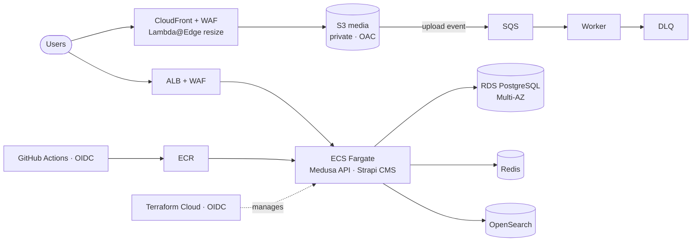

<!-- ===================== HEADER ===================== -->
<p align="center">
  
</p>

<p align="center">
  
</p>

<p align="center">
  <a href="https://linkedin.com/in/pandeyysatyam"></a>&nbsp;
  <a href="mailto:satyampande2006@gmail.com"></a>&nbsp;
  <a href="https://hashnode.com/@satyampandey"></a>&nbsp;
  <a href="https://instagram.com/pandeyy.satyam"></a>&nbsp;
  &nbsp;
  
</p>

<br/>

<!-- ===================== ABOUT ===================== -->
<table>
<tr>
<td width="58%" valign="top">

### About

DevOps Engineer with **3+ years** building and running production cloud infrastructure on **AWS**.

Right now at **Mayave**, I run a two-account (PROD + UAT) e-commerce platform written entirely in **Terraform**: 500+ resources, ECS Fargate microservices, and a global CloudFront + Lambda@Edge media pipeline.

I care about boring, reliable infrastructure: everything as code, every deploy reversible, every alarm worth waking up for.

</td>
<td width="42%" valign="top">

```yaml
role:    DevOps Engineer
now:     Mayave · E-commerce
iac:     Terraform · Terraform Cloud
runtime: ECS Fargate · Kubernetes (EKS)
deploy:  ArgoCD · GitHub Actions · Jenkins
observe: Prometheus · Grafana · OTel
learning:
  - Platform Engineering
  - Kubernetes Operators
```

</td>
</tr>
</table>

<!-- ===================== IMPACT ===================== -->
### Impact

<table>
<tr>
<td align="center" width="20%"><h2>500+</h2><sub>AWS resources<br/>managed as code</sub></td>
<td align="center" width="20%"><h2>85%</h2><sub>fewer<br/>deployment failures</sub></td>
<td align="center" width="20%"><h2>90%</h2><sub>fewer manual<br/>interventions (GitOps)</sub></td>
<td align="center" width="20%"><h2>50%</h2><sub>shorter<br/>release cycles</sub></td>
<td align="center" width="20%"><h2>30%</h2><sub>lower<br/>cloud spend</sub></td>
</tr>
</table>

<!-- ===================== STACK ===================== -->
### Stack

<p align="center">
  
</p>

<details>
<summary><b>Full stack</b></summary>
<br/>

| Area | Tools |
|---|---|
| **AWS** | ECS Fargate, EKS, EC2, ECR, S3, RDS, ElastiCache, OpenSearch, Lambda, Lambda@Edge, CloudFront, Route 53, VPC, ALB, Auto Scaling, IAM, WAF, KMS, Secrets Manager, SQS, SNS, EventBridge, CloudWatch, CloudTrail, GuardDuty, Security Hub, AWS Backup, FIS |
| **Azure** | Microsoft Azure, Azure DevOps Pipelines |
| **Containers** | Docker, Docker Compose, Docker Swarm, Kubernetes, Helm, Ingress |
| **CI/CD & IaC** | GitHub Actions, Jenkins, ArgoCD, Terraform, Terraform Cloud, Ansible, SonarQube |
| **Observability** | Prometheus, Grafana, Loki, CloudWatch, OpenTelemetry, Graylog, OpenSearch |
| **Networking & Security** | Nginx, SSL/TLS, DNS, Load Balancing, OpenVPN, Bastion Hosts, OIDC, Least-Privilege IAM |
| **Data & Scripting** | PostgreSQL, pgvector, Redis, MongoDB, Bash, Python, YAML, HCL |

</details>

<!-- ===================== PROJECTS ===================== -->
### Featured work

#### MayaveInfra · Production e-commerce platform on AWS
<sub>`Terraform Cloud` · `ECS Fargate` · `CloudFront` · `Lambda@Edge` · `RDS Multi-AZ` · `SQS` · `WAF` · `KMS` · `OIDC` · 2026</sub>



- **514 PROD + 256 UAT resources** as Terraform modules. PROD applies only from a VCS-driven **Terraform Cloud** workspace with **OIDC** auth and human-reviewed plans; no AWS access keys exist anywhere.
- PROD and UAT live in **separate AWS accounts**, each with a 3-tier VPC, **12 VPC endpoints**, and flow logs.
- **ECS Fargate** services auto-scale (2–6 tasks) behind ALBs, with health-check-gated **rolling deploys** of immutable ECR images.
- Private S3 behind **CloudFront + OAC**, on-the-fly resizing with **Lambda@Edge**, and an **S3 → SQS → worker → DLQ** async pipeline.
- **RDS PostgreSQL Multi-AZ** with PITR, **3 customer-managed KMS keys**, Secrets Manager at runtime, GuardDuty, Security Hub, and CloudTrail.
- **37 CloudWatch alarms** routed to Slack, **AWS Backup** (30-day daily / 90-day weekly), and chaos tests with **AWS FIS**.

<br/>

<table>
<tr>
<td width="33%" valign="top">

**Thryl & Evify**<br/>
<sub>Glazer Labs · 2024–26</sub>

Terraform multi-cluster ECS on a private 3-tier VPC, reached through a bastion and OpenVPN. ArgoCD GitOps cut manual interventions **90%**. Evify's event-driven backend (Lambda, SNS, SQS, EventBridge) cut manual ops **80%**.

</td>
<td width="33%" valign="top">

**Blue-Green CI/CD**<br/>
<sub>GitHub Actions · Docker · Nginx</sub>

Build → ECR → EC2/ECS pipeline with health checks, automatic rollback, and Nginx blue-green traffic switching for zero-downtime releases.

</td>
<td width="33%" valign="top">

**Docker Swarm + SSL**<br/>
<sub>Swarm · Nginx · EC2</sub>

Multi-node Swarm cluster on EC2 with overlay networking, Nginx TLS termination, and domain-based routing.

</td>
</tr>
</table>

<!-- ===================== EXPERIENCE ===================== -->
### Experience

| | Company | Role | Period |
|:-:|---|---|---|
| ● | **Mayave** · Jewellery e-commerce, Surat | DevOps Engineer | May 2026 – Present |
| ○ | **Glazer Labs**, Surat | DevOps Engineer | Apr 2024 – May 2026 |
| ○ | **ITechOps Software Development**, Ahmedabad | DevOps Engineer | Oct 2023 – Apr 2024 |
| ○ | **Sattvabit**, Surat | DevOps Engineer | Feb 2023 – Jun 2023 |

<sub>🎓 B.Tech, Computer Engineering, Vidhyapeeth Institute of Science & Technology (GTU), 2020–2024 · Diploma in Engineering, Bhagwan Mahavir Polytechnic, 2017–2019</sub>

<!-- ===================== ACTIVITY ===================== -->
### Activity

<p align="center">
  
</p>

<p align="center">
  
  
</p>

<!-- Snake animation: needs .github/workflows/snake.yml in this repo (see setup notes) -->
<p align="center">
  <picture>
    <source media="(prefers-color-scheme: dark)" srcset="https://raw.githubusercontent.com/pandeyysatyam/pandeyysatyam/output/github-snake-dark.svg"/>
    <source media="(prefers-color-scheme: light)" srcset="https://raw.githubusercontent.com/pandeyysatyam/pandeyysatyam/output/github-snake.svg"/>
    
  </picture>
</p>

<!-- ===================== FOOTER ===================== -->
<p align="center">
  
</p>
