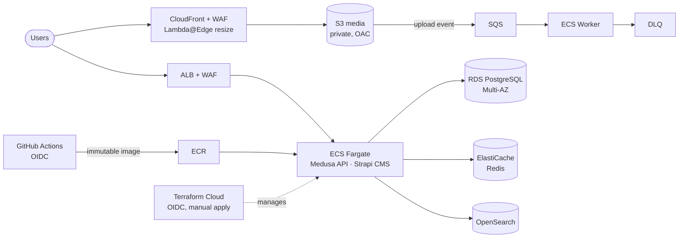

<!-- ===================== HEADER ===================== -->
<p align="center">
  
</p>

<p align="center">
  <a href="https://github.com/pandeyysatyam">
    
  </a>
</p>

<p align="center">
  <a href="https://linkedin.com/in/pandeyysatyam"></a>
  <a href="https://hashnode.com/@satyampandey"></a>
  <a href="mailto:satyampande2006@gmail.com"></a>
  <a href="https://instagram.com/pandeyy.satyam"></a>
  
</p>

---

### 👨‍💻 About Me

```yaml
name: Satyam Pandey
role: DevOps Engineer
experience: 3+ years running production cloud infrastructure
current: DevOps Engineer @ Mayave (Jewellery E-commerce)
location: Surat, Gujarat, India  # open to relocation & remote
focus:
  - Infrastructure as Code   # Terraform, Terraform Cloud
  - Containers               # ECS Fargate, Kubernetes (EKS), Helm
  - GitOps & CI/CD           # ArgoCD, GitHub Actions, Jenkins
  - Reliability              # observability, backups, DR, chaos testing (AWS FIS)
currently_learning: [Platform Engineering, Kubernetes Operators]
```

- 🔭 At **Mayave**, I run a two-account (PROD + UAT) AWS platform built entirely with **Terraform**: **500+ resources**, ECS Fargate microservices, and a global CloudFront + Lambda@Edge media pipeline.
- ✍️ I write about DevOps on [Hashnode](https://hashnode.com/@satyampandey).
- ⚡ Fun fact: I trust a `terraform plan` more than a weather forecast.

---

### 🛠️ Tech Stack

<p align="center">
  
  <br/>
  
</p>

<p align="center">
  
  
  
  
  
  
  
  
  
</p>

<details>
<summary><b>📋 Full stack (click to expand)</b></summary>

| Area | Tools |
|---|---|
| **AWS** | ECS Fargate, EKS, EC2, ECR, S3, RDS, ElastiCache, OpenSearch, Lambda, Lambda@Edge, CloudFront, Route 53, VPC, ALB, Auto Scaling, IAM, WAF, KMS, Secrets Manager, SQS, SNS, EventBridge, CloudWatch, CloudTrail, GuardDuty, Security Hub, AWS Backup, FIS |
| **Azure** | Microsoft Azure, Azure DevOps Pipelines |
| **Containers** | Docker, Docker Compose, Docker Swarm, Kubernetes, Helm, Ingress |
| **CI/CD & IaC** | GitHub Actions, Jenkins, ArgoCD, Terraform, Terraform Cloud, Ansible |
| **Observability** | Prometheus, Grafana, Loki, CloudWatch, OpenTelemetry, Graylog, OpenSearch |
| **Networking & Security** | Nginx, SSL/TLS, DNS, Load Balancing, OpenVPN, Bastion Hosts, OIDC, Least-Privilege IAM |
| **Data & Scripting** | PostgreSQL, pgvector, Redis, MongoDB, Bash, Python, YAML, HCL |

</details>

---

### 🏆 Impact in Numbers

<p align="center">
  
  
  
  
  
</p>

---

### 📂 Featured Projects

#### 🔷 MayaveInfra: Production E-commerce Platform on AWS (2026)

Full PROD + UAT infrastructure for a jewellery e-commerce platform, built with Terraform modules and run from Terraform Cloud.



- **IaC & governance:** **514 PROD + 256 UAT resources** as Terraform modules. PROD runs only from a VCS-driven **Terraform Cloud** workspace with **OIDC** auth (no AWS access keys anywhere) and manual plan review before apply. PROD and UAT live in **separate AWS accounts** to limit blast radius.
- **Network:** 3-tier VPC (public / private app / isolated DB subnets) with **12 VPC endpoints**, VPC Flow Logs, and bastion access.
- **Compute:** **ECS Fargate** services (Medusa API, Strapi CMS, SQS worker) with target-tracking auto scaling (server 2–6 tasks), ALB health-check-gated **rolling deploys**, and immutable ECR images.
- **Edge & media:** private S3 behind **CloudFront + OAC**, on-the-fly image resizing with **Lambda@Edge**, and an **S3 → SQS → worker → DLQ** async pipeline.
- **Data:** **RDS PostgreSQL 17 Multi-AZ** (30-day backups, PITR), ElastiCache Redis, OpenSearch for product search.
- **Security:** AWS WAF on ALBs and CloudFront, **3 customer-managed KMS keys**, Secrets Manager injected at runtime, CloudTrail, Config, GuardDuty, Security Hub, Inspector.
- **Reliability:** **37 CloudWatch alarms** → SNS → Lambda → Slack; **AWS Backup** (daily 30-day, weekly 90-day retention); chaos testing with **AWS FIS**.

`Terraform` `Terraform Cloud` `ECS Fargate` `CloudFront` `Lambda@Edge` `RDS` `SQS` `WAF` `KMS` `GitHub Actions` `OIDC`

---

#### 🔷 Thryl & Evify: Multi-Cluster ECS Infrastructure (Glazer Labs, 2024–2026)
- Terraform-built **3-tier AWS architecture** (custom VPC, NAT Gateway, S3 VPC Endpoint) serving two production platforms.
- ECS workers in **private subnets with no public IPs**, reached via bastion host + OpenVPN; multi-AZ ALB and auto scaling.
- **GitOps with ArgoCD** cut manual deployment interventions by **90%**. Evify's event-driven backend (**Lambda, SNS, SQS, EventBridge**) cut manual ops by **80%**.

#### 🔷 Blue-Green CI/CD Deployment System
- **GitHub Actions** pipeline: build → Docker image → ECR push → EC2/ECS deploy.
- Automated **health checks, rollback, and Nginx blue-green traffic switching** for zero-downtime releases.

#### 🔷 Docker Swarm Cluster with Nginx & SSL
- Multi-node **Docker Swarm** on EC2 (manager/worker) with overlay networking, **Nginx SSL/TLS termination**, and domain-based routing.

---

### 💼 Experience

| Role | Company | Period |
|---|---|---|
| **DevOps Engineer** | Mayave (Jewellery E-commerce), Surat | May 2026 – Present |
| **DevOps Engineer** | Glazer Labs, Surat | Apr 2024 – May 2026 |
| **DevOps Engineer** | ITechOps Software Development, Ahmedabad | Oct 2023 – Apr 2024 |
| **DevOps Engineer** | Sattvabit, Surat | Feb 2023 – Jun 2023 |

### 🎓 Education
- **B.Tech, Computer Engineering**, Vidhyapeeth Institute of Science & Technology (GTU), Surat *(2020 – 2024)*
- **Diploma in Engineering**, Bhagwan Mahavir Polytechnic, Surat *(2017 – 2019)*

---

### 📊 GitHub Stats

<p align="center">
  
  
</p>

<p align="center">
  
</p>

<!-- Snake animation: generated by .github/workflows/snake.yml -->
<p align="center">
  <picture>
    <source media="(prefers-color-scheme: dark)" srcset="https://raw.githubusercontent.com/pandeyysatyam/pandeyysatyam/output/github-snake-dark.svg"/>
    
  </picture>
</p>

<!-- ===================== FOOTER ===================== -->
<p align="center">
  
</p>
